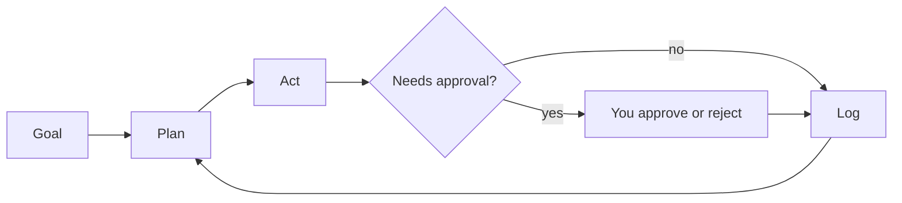

# StudyAssist

**An agentic AI study assistant that runs on your own computer.**

Upload your notes (PDFs, Word files, slides, spreadsheets, photos of pages). StudyAssist reads them, puts the topics in a sensible learning order, answers your questions with page-level citations, quizzes you, tracks which topics you are weak at, and plans your revision. For harder questions it can run a **jury of six AI roles** that debate and return one combined answer. Anything that changes your plan waits for your approval.

Built by team **VectorCode**.

---

## Contents

1. [What it does](#what-it-does)
2. [Requirements](#requirements)
3. [Quick start](#quick-start)
4. [Your first session](#your-first-session)
5. [A tour of the app](#a-tour-of-the-app)
6. [How it works](#how-it-works)
7. [Security and privacy](#security-and-privacy)
8. [Choosing a brain](#choosing-a-brain)
9. [Configuration files](#configuration-files)
10. [Project structure](#project-structure)
11. [Where your data lives](#where-your-data-lives)
12. [Running the tests](#running-the-tests)
13. [Troubleshooting](#troubleshooting)
14. [Known limitations](#known-limitations)
15. [Credits](#credits)

---

## What it does

| Feature | In plain words |
|---|---|
| **Universal upload** | Reads PDF, Word (.docx), PowerPoint (.pptx), Excel (.xlsx), text and Markdown, and images (PNG, JPG, BMP, WebP, TIFF). Scanned pages are read with OCR. |
| **Memory file per subject** | Splits your material into chunks, tags each with a topic, and orders topics so foundations come first. You can override the order. |
| **Cited answers** | Every answer can point back to the file and page it came from. |
| **Quick mode and Jury mode** | Quick mode uses one agent. Jury mode runs six role-based agents, a blind peer review, and a judge. |
| **Quizzes** | Generates multiple-choice questions grounded in your notes and grades your answers. |
| **Progress tracking** | Records quiz scores and shows your weakest topics. |
| **Revision planning** | Builds a spaced-repetition plan and exports an `.ics` calendar file. Needs your approval first. |
| **Accounts for families** | Each person has a login and a completely separate study profile on the same computer. |
| **Switchable brain** | Runs on a local model through Ollama by default. Can also use a Google Colab server or a cloud provider. |

---

## Requirements

- **Windows** (the launcher is a `.bat` file)
- **[Ollama](https://ollama.com)** to run the AI models locally
- **[Git](https://git-scm.com)** to download and update the project
- **Python 3.13 recommended.** The launcher tries Python 3.13, then 3.12, then your system Python. Very new Python versions (3.14 and later) may not have ready-made packages for ChromaDB and ONNX Runtime yet, so installing 3.13 avoids problems.
- **Optional:** [Tesseract OCR](https://github.com/UB-Mannheim/tesseract/wiki) to read scanned PDFs and images. Without it, text-based files still work.

**Hardware.** A 7B model needs roughly 5 to 8 GB of free memory. If answers are slow, use Quick mode or the smaller fallback model. The app has a built-in hardware check (see [A tour of the app](#a-tour-of-the-app)).

---

## Quick start

These are the confirmed working steps.

**1. Install Ollama** from [ollama.com](https://ollama.com), then make sure it is running.

**2. Download the models:**

```
ollama pull qwen2.5:7b
ollama pull qwen2.5:3b
ollama pull nomic-embed-text
```

- `qwen2.5:7b` is the main model.
- `qwen2.5:3b` is the lighter fallback.
- `nomic-embed-text` powers search. **Do not skip it**: without it, search quality drops without any warning (see [Troubleshooting](#troubleshooting)).

**3. Get the code.** First time:

```
git clone https://github.com/DubberRuckky/StudyAssist.git
```

To update an existing copy:

```
git pull
```

**4. Go into the project folder:**

```
cd StudyAssist
```

**5. Run it:**

```
./run.bat
```

(In PowerShell use `./run.bat`. In Command Prompt use `run.bat`.)

### What happens on the first run

The launcher does the setup for you:

1. Creates a private Python environment in `.venv` if one doesn't exist.
2. Installs everything in `requirements.txt` into it. This can take several minutes the first time.
3. Starts the app at **http://127.0.0.1:7860** (open it in your browser if it doesn't open by itself).

On later runs it skips the install unless `requirements.txt` has changed. If anything fails, the window stays open with an error message.

---

## Your first session

1. **Create a user.** On the login screen open the **Create User** tab. Choose a username (3 to 32 characters: letters, digits, underscore, dash) and a password (at least 10 characters).
2. **Save your recovery key.** It is shown **once**. It is the only way back in if you forget your password. Tick the box only after you have copied it somewhere safe.
3. **Log in.**
4. Open **Upload & Subjects**, type a subject name (for example `Physics`), choose your files, and press **Ingest Material**.
5. Open **Chat** and ask a question, or state a goal such as `Exam in 10 days, make a plan`.
6. Open **Progress & Quizzes** to generate a quiz on a topic and grade your answers.

---

## A tour of the app

| Tab | What you do there |
|---|---|
| **Log In / Create User / Account Recovery** | Sign in, make an account, or reset a password with your recovery key. |
| **Chat** | Ask questions or set goals. Pick a subject and choose **Quick (Single Agent)** or **Jury (6 Agents Debate)**. Citations appear beside the chat. |
| **Upload & Subjects** | Add files, tick **Local Only** to keep a subject away from remote brains, view and edit the learning order for each subject. |
| **Progress & Quizzes** | See weak topics and active revision plans, generate a grounded quiz, submit answers for grading. |
| **Approvals** | Approve or reject actions that need your permission (such as creating a revision plan). |
| **Brain & Settings** | Choose the brain profile, edit model name and URL, save API keys or tokens (kept in the OS keyring), test the connection, run the **Hardware Preflight Check**, change your password, or delete your account. |
| **Action Log** | A record of every brain call and tool run, with duration, tokens and approval result. |

---

## How it works

StudyAssist follows a simple loop:



1. **Goal:** you say what you want.
2. **Plan:** the brain decides which tool to use.
3. **Act:** the app runs the tool on your computer.
4. **Approve:** sensitive tools pause until you say yes.
5. **Log:** every action is saved to your Action Log. The loop repeats until the task is complete.

### The six tools

| Tool | Purpose |
|---|---|
| `ingest_material` | Parses files, runs OCR on scans, splits text into chunks with file and page references, tags topics, and saves the memory file and search index. |
| `search_notes` | Finds the most relevant passages for a question, with citations. |
| `run_jury` | Answers in Quick mode (one agent) or Jury mode (six agents). |
| `generate_quiz` | Makes grounded multiple-choice questions and grades answers. |
| `schedule_revision` | Builds a spaced-repetition plan and exports an `.ics` calendar file. **Requires approval.** |
| `track_progress` | Records scores and returns your weakest topics. |

### The jury

Jury mode sends the same retrieved notes to six roles. Each role carries a weight used by the judge:

| Role | Weight |
|---|---|
| Explainer | 1.0 |
| Rigorous expert | 1.2 |
| Skeptic | 1.1 |
| Exam coach | 1.3 |
| Example builder | 1.0 |
| Fact-checker | 1.4 |

Round 1 collects independent answers. In Round 2, role labels are removed so the critiques are **blind**. The judge then merges everything into one answer, giving more weight to higher-weighted roles. Jury mode makes many model calls, so it is slower than Quick mode. Quick mode is the default.

### Works with any model

Some models can't reliably call tools. In **portable mode**, StudyAssist asks the model to reply with a small JSON action, repairs common JSON mistakes, validates it, and retries if needed. This is how the default local models work (`native_tools` is `false` in their profiles).

---

## Security and privacy

**The promise:** your files and study data stay on your computer.

### Security

- **Passwords** are hashed with **Argon2id** (time cost 3, 64 MiB memory, 4 lanes), each with its own salt. Passwords are never stored in readable form.
- **Login defence:** after 5 failed attempts an account is locked for 5 minutes.
- **Sessions** use random 256-bit tokens, expire after 60 minutes of inactivity, and clear per-user caches when you log out.
- **Secrets** (API keys, Colab tokens) are stored per user in the Windows credential store (OS keyring), never in the config files.
- **Approval gate:** `schedule_revision` pauses for your approval.
- **Local only:** the web server binds to `127.0.0.1` with sharing turned off, so other devices cannot reach it.
- **Recovery key:** a 128-bit one-time key lets you reset a forgotten password.

### Privacy

- **One folder per user.** Each account has its own database, search index, memory files, uploads and logs. A `UserContext` object is passed to every function so users cannot reach each other's data, and file paths are checked to block path-traversal tricks.
- **Local brain by default.** With the default setup, nothing leaves your computer.
- **Local-only subjects.** Tick **Local Only** for a subject and it is never sent to a remote brain.
- **Warning before remote.** The first time a non-local brain (Colab or cloud) is used, the app warns you. With a remote brain, your questions and the note excerpts used to answer them are sent to that provider.
- **Single queue.** One brain call runs at a time, so requests from different users never overlap.
- **Git-ignored data.** `data/`, databases, keys and environment files are listed in `.gitignore`.

### What is not protected yet

- The search index (ChromaDB) and the study database (SQLite) are **not encrypted**.
- `storage/crypto.py` contains AES-256-GCM encryption for uploads and memory files, but it is **not switched on** in the app yet.
- Family members who share one Windows login can open the `data/` folder directly. For stronger separation, use separate Windows accounts or BitLocker.
- Profiles do **not sync** between computers.

---

## Choosing a brain

The "brain" is the language model that does the thinking. Profiles live in `config/providers.json` and can be changed in **Brain & Settings**.

| Profile | What it is | Privacy |
|---|---|---|
| `local_ollama` (default) | `qwen2.5:7b` through Ollama on your PC | Fully local |
| `local_fallback` | `qwen2.5:3b`, lighter and faster | Fully local |
| `colab_ollama` | Experimental Ollama server on Google Colab, reached through a tunnel | Remote |
| `remote_cloud` | Any cloud model through LiteLLM (OpenAI, Claude, Gemini and others). Default model name is `gpt-4o-mini`. | Remote |

- **Fallback order:** if the active brain fails, the app tries `local_ollama`, then `local_fallback`, then `colab_ollama`, and tells you when it switches.
- **Daily call cap:** 100 brain calls per user per day by default.
- **Changing a model:** pull it with `ollama pull <name>`, then edit the model name in Brain & Settings (or in `config/providers.json`) and press **Test Brain Connection**.

### Using a Colab brain (experimental)

Open `colab/brain_server.ipynb` in Google Colab and run it. It installs Ollama, pulls a model, starts a token-protected proxy and prints a public URL and token. Paste them into **Brain & Settings**. Colab limits web-service style use and may end sessions, so check Colab's current terms before relying on it. The app works fully without it.

### AMD graphics cards on Windows

If Ollama doesn't use your GPU, try its Vulkan backend by setting the environment variable `OLLAMA_VULKAN=1` and restarting Ollama. Run the **Hardware Preflight Check** in Brain & Settings to see your RAM, GPU type and measured tokens per second, along with advice. The NPU is not used.

---

## Configuration files

| File | What it controls |
|---|---|
| `config/providers.json` | Brain profiles, the active profile, and the fallback order. No secrets are stored here. |
| `config/settings.json` | Embedding model, hardware defaults, the approval list (`requires_confirmation`), the daily call cap, Argon2 and login settings, and jury roles and weights. |
| `requirements.txt` | Python packages. The launcher reinstalls when this file changes. |

Useful settings in `config/settings.json`:

| Setting | Default |
|---|---|
| `safety.daily_call_cap` | 100 |
| `safety.requires_confirmation` | `["schedule_revision"]` |
| `auth.max_failed_logins` / `auth.lockout_seconds` | 5 / 300 |
| `auth.session_timeout_minutes` | 60 |
| `hardware.default_mode` | `quick` |
| `embeddings.model` | `nomic-embed-text` |

---

## Project structure

```
StudyAssist/
├── app.py                 Starts the app (dependency check, tool registration, Gradio on 127.0.0.1:7860)
├── run.bat / run.ps1      Launchers: create .venv, install packages, start the app
├── requirements.txt       Python packages
├── agent/
│   ├── orchestrator.py    The Goal, Plan, Act, Approve, Log loop
│   ├── dispatcher.py      Tool registry and the approval gate
│   └── jury.py            Six-role jury, blind critique, weighted judge
├── auth/
│   ├── hasher.py          Argon2id passwords, username and password rules, recovery keys
│   ├── database.py        Account database, lockout, password change and reset
│   ├── service.py         Register, log in, log out, delete account
│   ├── session.py         Session tokens and idle timeout
│   ├── context.py         UserContext: each user's isolated paths and path-safety checks
│   └── keyring_service.py Per-user secrets in the OS keyring
├── models/
│   ├── brain.py           Single gateway to every brain: queue, fallback, daily cap
│   ├── tool_protocol.py   Portable JSON tool calling with repair and validation
│   ├── hardware.py        Hardware check and speed benchmark
│   └── mock_brain.py      Scripted fake brain for offline tests
├── storage/
│   ├── db.py              Per-user SQLite: scores, plans, subjects, action log
│   ├── memory.py          Subject memory files and learning-order sorting
│   ├── vector_store.py    ChromaDB search index and embeddings
│   └── crypto.py          AES-256-GCM encryption module (not yet enabled in the app)
├── tools/                 The six tools: ingest_material, search_notes, run_jury,
│                          generate_quiz, schedule_revision, track_progress
├── ui/
│   ├── dashboard.py       The whole Gradio interface and its handlers
│   └── auth_view.py       Login handling
├── config/                providers.json, settings.json, loader.py
├── colab/                 brain_server.ipynb for the optional Colab brain
├── tests/                 Automated tests
└── data/                  Created at runtime: accounts and user data (git-ignored)
```

---

## Where your data lives

Everything is created on first use under `data/`:

```
data/
├── auth.db                       Accounts (usernames, password hashes, lockout counters)
└── users/<random-id>/
    ├── study.db                  Progress, plans, subjects, action log
    ├── chroma/                   Search index
    ├── memory/                   Subject memory files (JSON)
    ├── uploads/                  Your files and exported .ics calendars
    └── logs/
```

Folders use a random id, not your username. Deleting an account removes its whole folder. Calendar files are saved as `uploads/revision_<subject>_<exam-date>.ics`. To back up or move a profile, copy its folder, but note that profiles are not designed to sync.

---

## Running the tests

The project has 65 automated tests that run offline using a scripted fake brain, so they need neither Ollama nor an internet connection. From the project folder:

```
.venv\Scripts\python.exe -m pytest
```

They cover login and hashing, user isolation, storage, the brain gateway and fallback, the agent loop and approval gate, ingestion and search, quizzes and planning, the jury, the interface, and dependency checks.

---

## Troubleshooting

| Problem | Likely cause and fix |
|---|---|
| `No module named ...` on start | Start the app with `./run.bat` so it uses the project's `.venv`. Running `python app.py` with another Python skips the installed packages. |
| Package install fails on first run | Very new Python versions may lack packages. Install Python 3.13 and delete the `.venv` folder, then run `./run.bat` again. |
| "Connection refused" or brain test fails | Ollama isn't running. Start it, then press **Test Brain Connection**. |
| "Model not found" | Pull it: `ollama pull qwen2.5:7b` (or the model named in your profile). |
| Answers are slow | Use Quick mode, switch to `local_fallback`, close heavy programs, and run the **Hardware Preflight Check**. On AMD graphics, try `OLLAMA_VULKAN=1`. |
| Search returns unrelated passages | `nomic-embed-text` isn't available, and the app silently falls back to placeholder embeddings. Run `ollama pull nomic-embed-text`, then delete the subject's data and ingest your files again. |
| Scanned PDFs or images give no text | Install Tesseract OCR (default path `C:\Program Files\Tesseract-OCR\`) and ingest again. |
| "Unsupported file type" | Use PDF, DOCX, PPTX, XLSX, TXT, MD, or an image file. |
| Account locked | Wait 5 minutes after 5 failed logins. |
| Forgot password | Use the **Account Recovery** tab with your recovery key. Without it there is no reset. |
| Port 7860 already in use | Close the other copy of StudyAssist (or whatever else uses port 7860). |
| Jury mode takes minutes | Expected on small local models. Use Quick mode for everyday questions. |

---

## Known limitations

- **No sync:** profiles live on one computer and don't sync between devices.
- **Encryption is not switched on:** the search index and database are unencrypted, and the file-encryption module is not yet enabled.
- **Colab brain is experimental** and may conflict with Colab's terms.
- **Local models are smaller** than cloud models, so quality and speed are lower, especially in Jury mode.
- **Embedding fallback:** if the embedding model is missing, search degrades without a warning.
- **Windows-first:** the launcher is a `.bat` file.

---

## Credits

Collaborators [Ezhil Josanta](https://github.com/ezhiljosanta), [Harini V](http://github.com/harini-vijayakumar).

Built with [Gradio](https://www.gradio.app), [Ollama](https://ollama.com), [ChromaDB](https://www.trychroma.com), [LiteLLM](https://github.com/BerriAI/litellm), [PyMuPDF](https://pymupdf.readthedocs.io), Tesseract OCR, and Argon2.

Parts of the code were written with the help of an AI coding agent from prompts written by the team.
