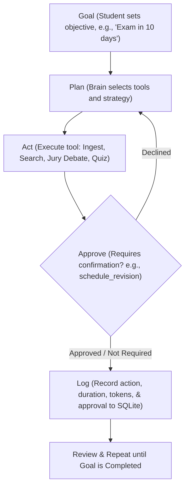

# StudyAssist — Agentic AI Study Assistant

> *Note: Parts of this codebase and documentation were written with the assistance of an AI coding agent.*

StudyAssist is an offline-first, agentic AI study companion that turns your personal study materials into structured learning plans and verified answers. It ingests your lecture slides, PDFs, notes, spreadsheets, and scanned diagrams, organizes them into a logical concept tree, and uses a 6-agent jury to debate and synthesize answers to your study questions. Built for complete privacy and family computers, every note, memory file, and progress record remains strictly local on your PC, while human-in-the-loop gates ensure you approve every revision plan before it changes.



---

## Table of Contents
1. [What This Is](#what-this-is)
2. [Quick Start](#quick-start)
3. [Choosing a Brain](#choosing-a-brain)
4. [Using an AMD GPU on Windows & Target Machines](#using-an-amd-gpu-on-windows--target-machines)
5. [Accounts, Login, and Isolation](#accounts-login-and-isolation)
6. [How It Works: Tools and the Jury](#how-it-works-tools-and-the-jury)
7. [Folder Map](#folder-map)
8. [Configuration Guide](#configuration-guide)
9. [How to Change Things](#how-to-change-things)
10. [Privacy & Security Notes](#privacy--security-notes)
11. [Testing Guide](#testing-guide)
12. [Troubleshooting](#troubleshooting)
13. [Glossary of Terms](#glossary-of-terms)
14. [Assumptions, Known Limitations & Maintenance Checklist](#assumptions-known-limitations--maintenance-checklist)

---

## 1. What This Is
StudyAssist transforms unstructured study files (PDFs, Word docs, PowerPoint presentations, Excel sheets, and images) into an interactive, masterable study plan. Rather than relying on a single AI response that might hallucinate, StudyAssist runs every difficult question through a 6-agent role-based jury that conducts blind critiques to formulate a single, cited, reliable answer. The entire application runs locally on your PC, protecting your private files and memory files, while offering flexible switchable brain backends.

---

## 2. Quick Start

### Windows Setup
1. **Install Python 3.13**:
   Download Python 3.13 from [python.org](https://www.python.org/) or install via winget:
   ```powershell
   winget install --id Python.Python.3.13
   ```
2. **Install Ollama & Pull Models**:
   Download Ollama from [ollama.com](https://ollama.com). Open PowerShell and pull the chat and embedding models:
   ```powershell
   ollama pull qwen2.5-coder:7b
   ollama pull nomic-embed-text
   ```
   *(Optional fallback model for lower memory: `ollama pull qwen2.5:3b`)*
3. **Run StudyAssist (Self-Repairing Quick Start)**:
   Simply run the self-repairing launcher:
   ```cmd
   run.bat
   ```
   *(Or double-click `run.bat` directly in File Explorer, or run `.\run.ps1` in PowerShell).*
   The launcher automatically initializes the `.venv` virtual environment if it does not exist, checks the checksum of `requirements.txt` to install/update dependencies, and launches the app.

   *(Manual alternative: `py -3.13 -m venv .venv && .\.venv\Scripts\Activate.ps1 && pip install -r requirements.txt && python app.py`)*

   Open your browser and navigate to `http://127.0.0.1:7860`.

### macOS & Linux Setup
1. Install Python 3.13 and Ollama.
2. Pull `qwen2.5:7b` and `nomic-embed-text`.
3. Create a virtual environment (`python3.13 -m venv .venv && source .venv/bin/activate`).
4. Run `pip install -r requirements.txt` and launch with `python app.py`.

---

## 3. Choosing a Brain

The "brain" is the language model reasoning engine. You can change the active brain profile at any time in `config/providers.json` or directly in the UI settings tab.

| Brain Profile | Privacy | Speed | Cost | Best Used For |
| :--- | :--- | :--- | :--- | :--- |
| **local_ollama** (Default: Qwen 2.5 7B) | 100% Local (0 data leaves PC) | Fast on dedicated GPU; moderate on CPU | Free | Daily private study, offline learning |
| **local_fallback** (Qwen 2.5 3B) | 100% Local | Very fast, low memory footprint | Free | Laptops with low free RAM or Quick mode |
| **colab_ollama** (Google Colab Tunnel) | Remote tunnel (Encrypted in transit) | Depends on allocated Colab GPU (T4/A100) | Free tier / Pro | Running 14B+ models without local GPU |
| **remote_cloud** (GPT-4o, Claude 3.5, Gemini) | Excerpts sent to cloud provider | Instant | Per-token API cost | Difficult jury queries or complex explanations |

### Step-by-Step Setup for Each:
- **Local Ollama**: Start Ollama desktop or run `ollama serve`. In Settings, ensure `http://localhost:11434` is reachable.
- **Colab Ollama**: Open `colab/brain_server.ipynb` in Google Colab, execute all cells, and paste the generated ngrok/tunnel URL and bearer token into Settings.
- **Cloud Providers (LiteLLM)**: Enter your API key in the Settings tab. It is saved directly into your operating system keyring under your private user ID.

---

## 4. Using an AMD GPU on Windows & Target Machines

StudyAssist is specifically tuned to run seamlessly across two target Windows machine classes:

### 1. Dedicated GPU Desktop (e.g., AMD RX 6600 8 GB VRAM, Ryzen 5 5600, 16 GB RAM)
- **Vulkan Recommendation**: On Windows, AMD cards deliver the best performance with Ollama using Vulkan. Set the system environment variable:
  ```powershell
  [System.Environment]::SetEnvironmentVariable('OLLAMA_VULKAN', '1', 'User')
  ```
- Ollama will offload the entire Qwen 2.5 7B model layers to the 8 GB dedicated VRAM while `nomic-embed-text` is kept on CPU, giving high generation speeds (>30 tokens/sec).

### 2. Shared-Memory Laptop (e.g., AMD Ryzen AI 7 350, Radeon 860M Integrated Graphics, 24 GB RAM)
- The GPU shares system RAM. StudyAssist automatically detects integrated/shared GPU architecture.
- **Do not attempt to use the NPU** for Ollama LLM execution as driver support is experimental.
- Use `OLLAMA_VULKAN=1` for Vulkan acceleration on the Radeon 860M.
- If free system RAM falls below 4 GB, StudyAssist triggers a warning and recommends switching to **Quick Mode** or the smaller `local_fallback` (3B) profile.
- Context length defaults to a conservative 2048 tokens to preserve shared RAM, with an aggressive keep-alive timeout (5m) to release memory.

---

## 5. Accounts, Login, and Isolation

StudyAssist is built for family computers where multiple individuals share a single machine but require strictly isolated study materials.

- **Argon2id Hashing**: Passwords are never stored in plaintext or encrypted; they are hashed with `Argon2id` using unique cryptographically random salts and constant-time verification.
- **Registration & Recovery Key**: Creating an account generates a secure one-time recovery key (`STUDY-...`). Save this key to unwrap encrypted backups or recover your account.
- **Throttling & Lockout**: Failed login attempts trigger exponential backoff. Exceeding 5 failed attempts locks the account for 5 minutes.
- **Isolated User Directories**: Every user's databases, ChromaDB vector collections, JSON memory files, uploads, and action logs reside exclusively within `data/users/<user_id>/` where `<user_id>` is an anonymous UUID.
- **Session Tokens**: Active logins hold an ephemeral 256-bit session token in memory. Logging out immediately flushes memory caches.
- **Light / Dark Mode Toggle**: The interface defaults to Light Mode on initial use and features a one-click toggle (`🌓 Light / Dark`) directly on the login screen and inside the dashboard banner. The user's theme selection is stored in browser `localStorage` and persists across page reloads and browser sessions.
- **Optional Storage Encryption at Rest**: Users can enable AES-256-GCM encryption for their uploaded lecture files and JSON memory files via `storage/crypto.py`. The encryption master key is wrapped by both the password and the recovery key, allowing recovery even if the password is forgotten. Note: ChromaDB vector collections and SQLite databases remain unencrypted for fast query indexing.

---

## 6. How It Works: Tools and the Jury

StudyAssist operates through 6 core agent tools:

1. **`ingest_material`**: Parses PDFs (`PyMuPDF`), Word docs (`python-docx`), slide decks (`python-pptx`), sheets (`openpyxl`), and images (`pytesseract` OCR). It extracts key concepts and prerequisite levels, then sorts them into a learning sequence using deterministic topological sorting in code.
2. **`search_notes`**: Queries ChromaDB vector embeddings to retrieve relevant source excerpts with page and file citations.
3. **`run_jury`**: Submits a complex student question to six specialized roles:
   - *Explainer*: Simple intuitive analogies.
   - *Rigorous Expert*: Formal technical precision.
   - *Skeptic*: Probes corner cases and misconceptions.
   - *Exam Coach*: Focuses on high-yield grading patterns.
   - *Example Builder*: Constructs concrete application scenarios.
   - *Fact-Checker*: Audits claims against source material.
   *Jury Flow*: In Round 1, each agent answers independently. In Round 2, role names are stripped for blind peer critiques. A weighted synthesis engine merges the critiques into one cited answer.
4. **`generate_quiz`**: Produces grounded questions directly from notes, validates schemas with retry logic, and records answers.
5. **`schedule_revision`**: Builds a spaced-repetition plan using weak topics and target dates, exporting standard `.ics` calendar files. **Requires human approval before saving.**
6. **`track_progress`**: Aggregates quiz performance in SQLite to track topic mastery and weak areas.

---

## 7. Folder Map

| Folder / File | Purpose |
| :--- | :--- |
| `app.py` | Main entry point launching the local Gradio web application |
| `run.ps1` | PowerShell one-click launcher ensuring `.venv` execution |
| `run.bat` | Windows batch launcher for double-click startup |
| `.gitignore` | Git exclusions for user databases, secrets, virtualenv, and caches |
| `requirements.txt` | Complete list of pinned Python dependencies |
| `config/providers.json` | LLM brain profiles and fallback preferences (no secrets) |
| `config/settings.json` | System settings (embeddings on CPU, Argon2id parameters, jury weights) |
| `config/loader.py` | JSON configuration loading and saving utilities |
| `auth/database.py` | Global authentication database (`data/auth.db`) |
| `auth/hasher.py` | Argon2id password hashing and recovery key generator |
| `auth/context.py` | `UserContext` object encapsulating user paths and security checks |
| `auth/session.py` | 256-bit in-memory session manager with timeout enforcement |
| `auth/keyring_service.py`| OS keyring wrapper storing per-user API keys |
| `models/brain.py` | Sole LLM interface exposing `chat(messages, tools, options)` |
| `models/mock_brain.py` | Deterministic offline mock brain for testing |
| `models/hardware.py` | Hardware preflight check (RAM, GPU type, Ollama tokens/sec) |
| `storage/db.py` | User-isolated SQLite database for progress, plans, and action logs |
| `storage/vector_store.py`| User-isolated ChromaDB client for vector embeddings |
| `storage/memory.py` | Per-subject JSON memory file manager and topic graph |
| `storage/crypto.py` | Optional AES-256-GCM encryption at rest for raw documents |
| `agent/orchestrator.py` | Agent loop (`run_agent`) executing Goal, Plan, Act, Approve, Log |
| `agent/dispatcher.py` | Tool registry and human approval gate dispatcher |
| `agent/jury.py` | 6-agent jury debate coordinator and synthesizer |
| `tools/` | Implementations of the six canonical tools |
| `ui/` | Gradio interface components and views |
| `colab/brain_server.ipynb`| Optional Google Colab Ollama proxy server with token authentication |
| `tests/` | Comprehensive test suite running offline with `pytest` |

---

## 8. Configuration Guide

### `config/providers.json`
```json
{
  "active_profile": "local_ollama",
  "fallback_order": ["local_ollama", "local_fallback", "colab_ollama"],
  "profiles": {
    "local_ollama": {
      "provider_type": "ollama",
      "model": "qwen2.5:7b",
      "base_url": "http://localhost:11434",
      "is_local": true,
      "native_tools": false,
      "max_parallel_calls": 1,
      "context_length": 4096
    }
  }
}
```

### `config/settings.json`
```json
{
  "embeddings": {
    "model": "nomic-embed-text",
    "run_on_cpu": true,
    "ollama_url": "http://localhost:11434"
  },
  "safety": {
    "requires_confirmation": ["schedule_revision"],
    "daily_call_cap": 100
  }
}
```

---

## 9. How to Change Things

- **Add a New Tool**: Define the tool function in `tools/`, decorate it, and register it in `agent/dispatcher.py`. If it modifies data, add it to `requires_confirmation` in `config/settings.json`.
- **Add a Brain Provider**: Add an entry under `profiles` in `config/providers.json`. If using LiteLLM, specify `provider_type: "litellm"`.
- **Modify Jury Roles or Weights**: Edit the `jury` section in `config/settings.json` to add new personas or adjust influence weights.

---

## 10. Privacy & Security Notes

### What Stays on the PC
- All uploaded PDFs, documents, slide decks, and images.
- All ChromaDB vector indexes and SQLite databases.
- All JSON subject memory files and study plans.
- Passwords (hashed via Argon2id) and recovery keys.

### What is Sent to a Remote Brain (When Non-Local Brain is Enabled)
- Only the specific question asked by the student and the small retrieved note excerpts necessary to answer it.
- A one-time warning dialog appears in the UI whenever a remote brain is activated.
- You can enable the **"Local Only" toggle per subject** in the Uploads tab to strictly force local execution for sensitive subjects.

### Security Boundaries
- **Shared Windows Accounts**: Family members sharing a single Windows login account can access the filesystem directly via File Explorer. We recommend using separate Windows user profiles or BitLocker drive encryption for full disk security.
- **Unencrypted Local Databases**: Note that while raw uploaded files can be encrypted with AES-256-GCM, SQLite and ChromaDB files are not encrypted by the app to maintain search performance.

---

## 11. Testing Guide

Run the complete 63-test offline test suite at any time:
```powershell
.\.venv\Scripts\pytest.exe -v tests/
```
All tests use `MockBrain` and execute fully offline without requiring an active network connection or running Ollama server. Tests validate:
- Configuration parsing, OS keyring secrets, and MockBrain response queuing (`test_milestone1.py`)
- Argon2id hashing, lockout throttling, and path traversal protection (`test_milestone2_auth.py`)
- SQLite progress, weak topics, and ChromaDB vector store isolation (`test_milestone3_storage.py`)
- Brain fallback chains, hardware preflight checks, and portable JSON schema repairs (`test_milestone4_brain.py`)
- Agent loop, iteration caps, and dispatcher human confirmation gate (`test_milestone5_agent.py`)
- Multi-format ingestion (PDF, DOCX, PPTX, XLSX, TXT, OCR) and note search (`test_milestone6_ingest_search.py`)
- Grounded quiz generation, scoring, and spaced-repetition `.ics` exports (`test_milestone7_quiz_progress_schedule.py`)
- 6-agent deliberative jury debate, blind peer reviews, and weighted synthesis (`test_milestone8_jury.py`)
- Gradio Blocks dashboard, 127.0.0.1 binding, and tool registration (`test_milestone9_ui.py`)
- Brain resilience, daily caps, hardware heuristics, and AES-256-GCM encryption (`test_milestone10_resilience_crypto.py`)
- Documentation completeness and section integrity (`test_docs.py`)
- End-to-end user workflow smoke testing (`test_smoke.py`)

---

## 12. Troubleshooting

| Symptom | Likely Cause | Fix |
| :--- | :--- | :--- |
| **ModuleNotFoundError (e.g. `requests`)** | App launched using system Python instead of `.venv`, or dependencies not installed | Launch via `run.bat` (or `run.ps1`) to automatically create `.venv` and install dependencies, or run `.\.venv\Scripts\python.exe -m pip install -r requirements.txt` |
| **`chromadb` dependency conflict (`onnxruntime`)** | Python 3.14+ used instead of Python 3.13 (no precompiled onnxruntime wheels for 3.14+) | Install Python 3.13 from python.org, delete `.venv`, and re-run `run.bat` |
| **Ollama not running** | Ollama service is closed | Launch Ollama from Start Menu or run `ollama serve` |
| **Model not loaded** | Model was not pulled | Run `ollama pull qwen2.5:7b` in terminal |
| **GPU not used on AMD** | Vulkan environment variable missing | Set `OLLAMA_VULKAN=1` in Windows environment variables and restart Ollama |
| **Slow responses** | Low VRAM or CPU execution | Switch UI to **Quick Mode** or choose `local_fallback` (3B model) |
| **Empty search results** | Document not yet ingested | Ingest materials in Upload tab and check that chunks were generated |
| **Approval stuck** | Pending confirmation | Open the **Approvals** tab in the UI and click Approve or Reject |
| **Colab link dead** | Colab runtime disconnected | Re-run cells in `colab/brain_server.ipynb` and update URL in Settings |

---

## 13. Glossary of Terms
- **Agent**: An autonomous software loop that pursues goals using planning, tools, and actions.
- **Brain**: The backend LLM powering reasoning and answering.
- **Embedding**: A numerical vector representing the semantic meaning of a text passage.
- **Jury**: A panel of diverse LLM personas that critique each other to arrive at an accurate answer.
- **OCR**: Optical Character Recognition, turning scanned images into searchable text.
- **Argon2id**: State-of-the-art password hashing algorithm resistant to GPU cracking.
- **Recovery Key**: A high-entropy cryptographic secret used to recover accounts.

---

## 14. Assumptions, Known Limitations & Maintenance Checklist

### Known Limitations
- **No Sync**: StudyAssist is intentionally a single-computer system. Profiles and study files live on one local computer and do not sync between devices (multi-device synchronization is planned for a future revision).
- **OCR Quality**: Handwritten notes require clear lighting for optimal OCR extraction via pytesseract.

### Maintenance Checklist
- [ ] Any new tool added must be registered in `tools/`, `agent/dispatcher.py`, and documented here.
- [ ] Every function must retain a clear, one-line English docstring.
- [ ] All tests must pass completely offline via `pytest`.
- [ ] Always update `CHANGELOG.md` upon completing milestone changes.
